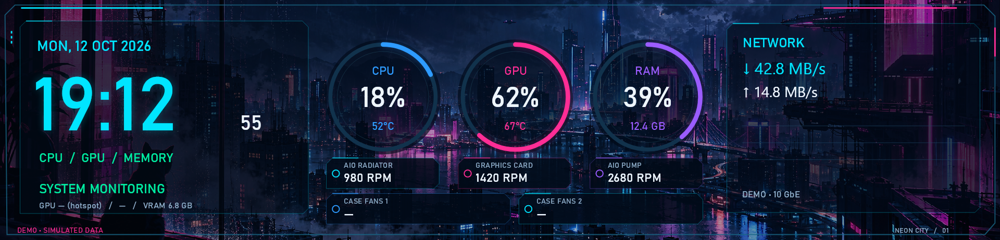
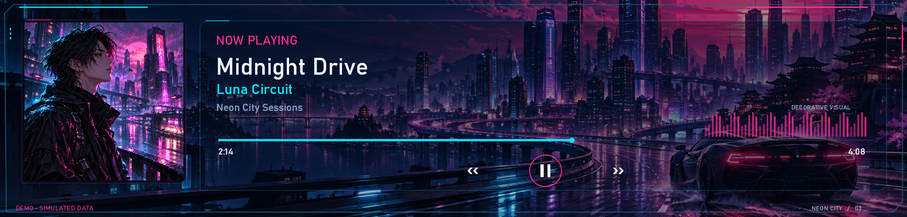
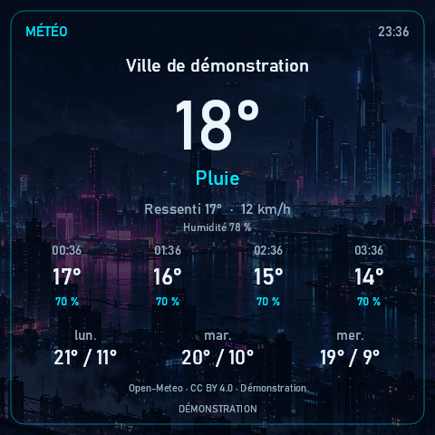
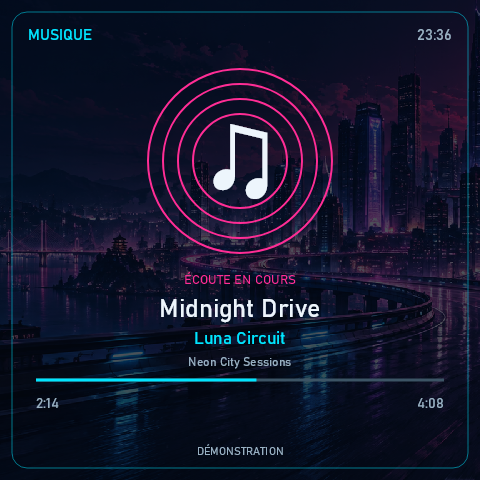

<div align="center">

# LOU Control Center

**Your PC. Your displays. Your information.**

A Windows application that transforms your Thermalright PC case and AIO displays into customizable dashboards, with optional RGB lighting control.


[](LICENSING.md)

[](https://github.com/Sandoiitchisan/LOU-Control-Center/releases/download/v2.2.0/LOU-Control-Center-Setup-2.2.0-win-x64.exe)

[Portable version](https://github.com/Sandoiitchisan/LOU-Control-Center/releases/download/v2.2.0/LOU-Control-Center-Portable-2.2.0-win-x64.zip) · [Release notes](https://github.com/Sandoiitchisan/LOU-Control-Center/releases/tag/v2.2.0) · [Installation guide](docs/INSTALLATION.md)

[Browse 2.2.0 source](https://github.com/Sandoiitchisan/LOU-Control-Center/tree/v2.2.0) · [Download source ZIP](https://github.com/Sandoiitchisan/LOU-Control-Center/releases/download/v2.2.0/LOU-Control-Center-Sources-2.2.0.zip) · [Previous RC1](https://github.com/Sandoiitchisan/LOU-Control-Center/releases/tag/v2.2rc1)

</div>



*Screenshots generated by the application using demo data.*

## Everything you need, at a glance

CPU temperature, currently playing music, weather forecasts, or gaming performance: LOU Control Center brings this information together on the displays already built into your PC.

Use an AIO display, a larger case display, or both simultaneously. Choose which pages to show and how often they rotate. Each display maintains its own independent settings, all managed through a unified interface.

> **Languages:** French and English are included in the same app. Choose **Settings → Language → English / Français**, then **Save and apply**. The interface and your displays switch together.

## Display diagnostics

**Screen not recognized?** [Download LOU Diagnostics](https://github.com/Sandoiitchisan/LOU-Control-Center/releases/download/diagnostics-v1.0.0/LOU-Diagnostics.exe), a separate portable Windows tool that generates an anonymized local text report for display compatibility issues. It performs no RGB scan, needs no LOU installation, and uploads nothing. Its GitHub button opens a new issue where you can attach the report yourself. [Instructions and source](docs/DIAGNOSTICS.md).

## New in 2.2 — RGB and more display formats

- A bilingual **RGB** section for devices, zones, colors, supported hardware effects, brightness and speed.
- **17 built-in lighting choices:** static/off, breathing, rainbow, color cycle, wave, comet, pulse, sparkle, rainbow wave, chase, scanner, blink, alternating, fire, aurora and ripple, on compatible direct-color controllers.
- OpenRGB 1.0 included, with a localhost-only engine and optional administrator access for supported RAM and motherboards.
- Per-device scene profiles, persistent ARGB LED counts and opt-in application at startup. Unknown or ambiguous device identities block writes.
- The existing display rendering and read-only cooling monitoring remain independent.
- Native HID type-2 support for the Trofeo 6.86-inch family, LY1 and ALi/WinUSB paths, documented RGB565 formats and layouts for 1280 × 480, 1600 × 720 and related rectangular displays.
- Improved AMD fallback temperature handling and physical GPU identity matching. The reported RX 9060 XT temperature issue is confirmed fixed by user feedback.

**2.2.0 is the stable release**, promoted from RC1 after user feedback. Choose the self-contained Windows x64 installer or portable ZIP. Close TRCC and other LOU instances before launch. Version 2.1.1 users can obtain this stable release through the built-in update check.

**242 automated tests passed**, and the standalone executable generated **220 preview images** across eleven geometries in French and English. Users reported positive results with additional screens; this does not establish compatibility for every model or revision. SCSI and HID type-3 devices are identified but cannot receive images yet. GPU RGB is not validated on the reference GPU. See [RGB support and limits](docs/RGB.md), the [display compatibility matrix](docs/USB_COMPATIBILITY.md), and [2.2.0 release details](docs/RELEASE-2.2.0.md).

## What’s new in 2.1.1

- **French + English:** one application, with a language selector in Settings. Both ultrawide and compact display layouts are translated too.
- **Built-in update checks:** an optional check at startup and a **Check now** button look for newer stable GitHub releases. LOU offers the correct installer or portable ZIP in your browser; it never installs updates automatically.
- **A smooth upgrade:** existing sensor assignments, custom names, display profiles and page intervals are kept. Existing configurations stay in French until you choose otherwise.
- **English documentation and a bilingual installer**, plus a fix for decimal input when switching languages.

[Full changelog](CHANGELOG.md) · [2.1.1 release notes](https://github.com/Sandoiitchisan/LOU-Control-Center/releases/tag/v2.1.1)

## Five pages for your everyday needs

| Page | What it displays |
|---|---|
| **System** | CPU, GPU, and RAM usage, temperatures, fan and pump speeds when available, and network throughput in MB/s. |
| **Weather** | Current conditions and forecasts. Search for your city and select the correct result. No API key required. |
| **Music** | Track title, artist, playback progress, and album artwork when provided to Windows by your media player. |
| **Gaming** | Detected game, presentation frame rate measured with PresentMon, GPU usage, and game window dimensions. |
| **Ambient** | Clock and decorative visuals for a more subtle display experience. |



## Small displays, full functionality

All five pages feature layouts optimized for compact displays. Only have an AIO screen? You can still access system monitoring, weather, music, gaming, and ambient visuals.

A dedicated view for CPU temperature and cooling information is also available.

<p align="center">
  
  
</p>

## A display experience tailored to your setup

- **Detection of compatible displays**, with adjustable orientation and a test pattern for verification.
- **Independent pages, ordering, timing, and transitions** for each display.
- **Custom colors, animation intensity, night mode, and background images**.
- **AMD/NVIDIA temperature and fan monitoring**, depending on the sensors exposed by your hardware and drivers.
- **Configurable sensor mapping**: choose which readings correspond to your radiator fans, case fans, or pump.
- **Read-only hardware monitoring**: your fan curves remain controlled by your BIOS and existing software.
- **Weather without an API key**, with cached forecasts available when the network connection is interrupted.

## Download and get started

### Windows installer — Recommended

[Download the standalone 2.2.0 installer for Windows x64](https://github.com/Sandoiitchisan/LOU-Control-Center/releases/download/v2.2.0/LOU-Control-Center-Setup-2.2.0-win-x64.exe)

**The installer includes the required components**: the .NET runtime, monitoring tools, the official signed PawnIO installer for hardware sensors, and visual assets. No additional downloads are required to install these components. An internet connection is still required for weather and GitHub update checks.

1. Close TRCC and any other software currently using your Thermalright displays.
2. Run the installer and approve the Windows permission prompt. Starting with Windows is offered as an optional setting.
3. Open LOU Control Center and verify your devices under **Displays (Écrans)**.
4. Under **Sensors (Capteurs)**, map your fans and pump to the appropriate readings based on your hardware connections.
5. Under **Weather (Météo)**, search for your city, select it, and save your settings.

The application then runs with standard user permissions. Advanced sensor monitoring is handled by the background component installed during setup.

> The LOU installer is not yet publisher-signed, so Windows may display a reputation warning. Included third-party components are their official signed versions. File checksums are available in [SHA256SUMS.txt](https://github.com/Sandoiitchisan/LOU-Control-Center/releases/download/v2.2.0/SHA256SUMS.txt).

### Portable version

[Download the portable 2.2.0 ZIP](https://github.com/Sandoiitchisan/LOU-Control-Center/releases/download/v2.2.0/LOU-Control-Center-Portable-2.2.0-win-x64.zip), extract its entire contents into a writable folder, and launch `Lou.ControlCenter.exe`.

Settings and images remain in the `Data` folder. LOU does not create a persistent background task in portable mode. Advanced sensor monitoring may require Windows administrator approval and the installation of PawnIO if it is not already present. Once enabled, this temporary monitoring component stops when the application closes.

## Compatibility

**Windows 10 version 2004 (build 19041) or later, or Windows 11, x64.**

### Officially tested and supported displays

LOU Control Center has been developed and tested on the following Thermalright devices:

| Device | Display resolution | Validation |
|---|---|---|
| **Thermalright A70 Vision White** (PC case) | **1920 × 462** | **Tested and supported** |
| **Thermalright Peerless Vision 360 ARGB White** (AIO liquid cooler) | **480 × 480** | **Tested and supported** |

Both displays have been successfully tested **running simultaneously**, with independent configurations and dashboard layouts.

**These are currently the only two officially validated devices.** Other Thermalright displays using compatible USB controllers and recognized JPEG protocols may also work, but compatibility is not guaranteed until verified on actual hardware.

### Technical compatibility — stable 2.2.0

| Component | Current support |
|---|---|
| Established Thermalright support | **LY** (`0416:5408`) and **ChiZhu** (`87AD:70DB`) families, with recognized JPEG display profiles. |
| Added in 2.2 | HID type 2 (`0416:5302`), LY1 (`0416:5409`), ALi (`0416:5406`, WinUSB only), expanded ChiZhu profiles and documented RGB565 formats. New families need physical validation. |
| Detected but unsupported transports | SCSI (`0402:3922`, `87CD:70DB`), HID type 3 (`0418:5303`, `0418:5304`) and non-WinUSB ALi variants. |
| Other display variants | Recognized profiles may be detected, but functionality must be verified on each specific model. |
| Temperatures and RPM | Readings provided by LibreHardwareMonitor, supplemented by AMD ADL. Availability depends on the hardware. |
| NVIDIA | Supported by the monitoring library, but validation on physical NVIDIA hardware is still pending. |
| Music players | Applications that expose playback information through Windows media sessions. |

The Thermalright brand alone does not guarantee compatibility with every display model. Unknown formats are rejected; Version 2.2 adds specific documented RGB565 formats. Native HID support requires no driver replacement. Windows automatically provides the driver for devices that declare WinUSB compatibility; other variants may require their manufacturer's driver. See the [detailed matrix](docs/USB_COMPATIBILITY.md).

Game detection relies on graphics activity and software heuristics, so some games may require user-defined exceptions. FPS values represent presentation frame rates, without distinguishing rendered frames from generated frames. The reported resolution corresponds to the game window. FSR, DLSS, HDR, and frame generation are not detected.

### Help expand compatibility

Own another Thermalright display? Open a [GitHub Issue](https://github.com/Sandoiitchisan/LOU-Control-Center/issues) with the exact model, display resolution, and observed behavior to help document compatibility. Please remove personal identifiers from screenshots and logs before submitting them.

[USB compatibility and protocols](docs/USB.md) · [Installation and troubleshooting](docs/INSTALLATION.md)

## Roadmap

RGB control and broader display support are included in 2.2. Upcoming work includes:

### 1. Portrait layouts (2.2.1)

Adapt all five dashboard pages for vertically mounted displays, using their full height while preserving readability and existing per-display orientation settings.

### 2. MP4 video backgrounds

Support for **MP4 videos as animated display backgrounds**, allowing users to customize their screens with video loops instead of static images, while keeping the interface responsive.

### 3. Broader hardware validation

Validate additional Thermalright models and RGB controllers from user reports, including GPU lighting. Implement remaining display transports as reliable protocol evidence and hardware validation become available.

> These are planned features, not release commitments. Their scope and implementation may evolve during development.

## Project status

Version 2.1.1 has passed **145 automated tests**, including French/English switching, settings compatibility and update checking. Its standalone preview was tested in both languages. The 2.1.1 installer, standard-user launch, sensor collection, settings preservation and uninstallation were verified on the reference PC. Simultaneous display testing achieved approximately **24 FPS** and **10 FPS**, respectively. Repair was also verified for 2.1.0.

These results apply to the tested hardware. Further testing on clean Windows installations, different graphics cards, and additional displays will help expand compatibility validation. Frame rates depend on the display model and configuration.

Testing with another display? Feedback through [GitHub Issues](https://github.com/Sandoiitchisan/LOU-Control-Center/issues), including the exact model and observed behavior, will help document compatibility. Please remove any personal identifiers from screenshots and logs before submitting them.

[Validation report](docs/VALIDATION.md)

## Built with AI, refined on real hardware

Yes — this is a **vibe-coded project**. LOU Control Center was built with substantial help from OpenAI Codex, starting with a very practical goal: make the displays in a real PC useful, attractive and easy to manage.

AI helped turn ideas into working software quickly; hands-on testing and user feedback shaped the result. That does not make the code infallible or guarantee support for every PC. The source is available to read, the tests and known limits are documented, and bug reports and code reviews are welcome. Changes and redistribution require permission; see the licensing section. The aim is simple: be honest about how it was made, and keep making it better.

## Development and contributions

The project is built with **C# / .NET 10, WPF, and SkiaSharp**.

```powershell
# Build, test, and create the portable package
./scripts/build.ps1

# Also create the installer (requires Inno Setup 6)
./scripts/build.ps1 -Installer
```

The .NET 10 SDK is required to build from source, but not to run published packages. The GitHub workflow builds Windows packages and runs automated tests. The [2.2.0 tag](https://github.com/Sandoiitchisan/LOU-Control-Center/tree/v2.2.0) contains the stable implementation, including the separate RGB and Diagnostics projects. See [release and build details](docs/RELEASE-2.2.0.md); the RC1 source remains available under its original tag.

[Contributing](CONTRIBUTING.md) · [Architecture](docs/ARCHITECTURE.md) · [Security](SECURITY.md)

## License and credits

The owner's intended terms for original **2.2** LOU material are **[PolyForm Strict 1.0.0](LICENSE)**: free for permitted noncommercial use, with commercial use, redistribution and derivative versions subject to prior authorization. This is source-available, not an OSI open-source license. **The protocol provenance/relicensing review remains unresolved**; publication does not establish that all earlier material can be relicensed. The intended restrictions apply only to rights the owner actually holds. See [licensing status](LICENSING.md) and the [review record](docs/LICENSING_REVIEW.md).

**2.1.1 and earlier remain GPL-3.0**, including their existing commercial-use permissions. The change cannot revoke rights already granted. Third-party components retain their own licenses; OpenRGB remains an independent GPL program. [Scope and commercial licensing](LICENSING.md).

LOU is an independent project, not affiliated with Thermalright, OpenRGB or hardware manufacturers.

The project uses several components, including LibreHardwareMonitor, PresentMon, PawnIO, and SkiaSharp. Weather data is provided by [Open-Meteo](https://open-meteo.com/), with city search powered by GeoNames. Public API access without a key is intended for non-commercial use within the service's usage limits. Weather data is attributed under CC BY 4.0.

[Full third-party licenses and attributions](THIRD_PARTY_NOTICES.md) · [Visual asset credits](docs/ASSETS.md)
