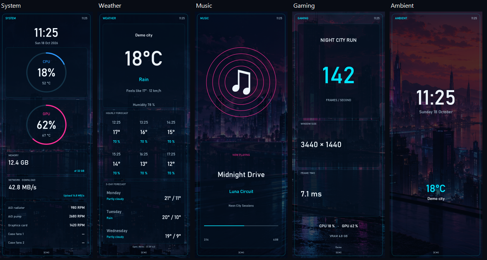

# LOU Control Center 2.2.1 — portrait layouts

Published on 18 October 2026 as the latest stable release. [Release and downloads](https://github.com/Sandoiitchisan/LOU-Control-Center/releases/tag/v2.2.1). The portrait branch has been merged into `main`. The immutable `v2.2.1` tag identifies source commit `6b18de8fe39886b08ec2c764d67f419463e6e2b1`, matching the original published packages. Later documentation corrections on `main` do not alter those binaries or their tag.

## Vertical dashboards

System, weather, music, gaming and ambient now have portrait compositions. The renderer uses the oriented display dimensions, keeping fonts, circles and cover art in proportion. Long displays use stacked sections; small portrait displays use denser cards. The dedicated cooling view also fills a portrait display, using the same read-only sensor assignments.

In **Displays**, select your screen, choose **90° or 270°** for a landscape panel mounted vertically, then **Save and apply**. Use the existing calibration pattern if needed to find the correct direction. A panel whose native dimensions are already portrait uses the vertical layout at 0°/180°. Square displays keep their square layout. Each screen retains its own orientation, pages, interval and frame-rate setting.

The overview preview allows more height for portrait screens. French and English remain in the same application. No settings migration, USB driver replacement, new sensor binding or fan-control change is required.

## Packages

- `LOU-Control-Center-Setup-2.2.1-win-x64.exe`: self-contained universal-edition installer, including the .NET runtime, assets and sensor dependencies. This upgrades an existing universal installation; it does not create another universal installation alongside it.
- `LOU-Control-Center-Portable-2.2.1-win-x64.zip`: extract completely into a writable folder and run `Lou.ControlCenter.exe`.

Close TRCC and other LOU instances before using a display. Keep your portable `Data` folder when migrating settings. The personal edition and its settings remain separate. The installer is not publisher-signed.

[Source ZIP](https://github.com/Sandoiitchisan/LOU-Control-Center/releases/download/v2.2.1/LOU-Control-Center-Sources-2.2.1.zip) · [SHA-256 checksums](https://github.com/Sandoiitchisan/LOU-Control-Center/releases/download/v2.2.1/SHA256SUMS.txt) · [Source manifest](https://github.com/Sandoiitchisan/LOU-Control-Center/releases/download/v2.2.1/SOURCE-MANIFEST.json)

The source ZIP is an archive of the original tag, including its then-current candidate documentation. For updated publication status, use this document on main. The installer and portable files have not been replaced.

## Verification

- 256 automated application tests passed, including full-height portrait framing, 90°/270° encoding back to the negotiated physical raster, missing fan readings, night mode and long media metadata/cover art.
- The standalone executable exported 320 preview images: sixteen geometries, five pages, real-data-unavailable and simulated states, in French and English. Additional dedicated cooling and long-label previews were checked.
- Offline render plus JPEG encoding measured medians of approximately 8–12 ms and a worst measured 95th percentile below 16 ms on the development PC, at 480 × 1280 and 462 × 1920. These are CPU-side measurements, **not measured USB/display FPS**.
- Portrait layouts were reviewed visually. A post-release report in [issue #3](https://github.com/Sandoiitchisan/LOU-Control-Center/issues/3) says the pages work and requests larger text. This community report does not establish exact model/revision coverage. Installer execution was not retested for 2.2.1; the running personal edition was not stopped or changed for the local checks.

The display protocol and hardware compatibility limits from 2.2.0 still apply. The [licensing provenance review](LICENSING_REVIEW.md) remains unresolved.
