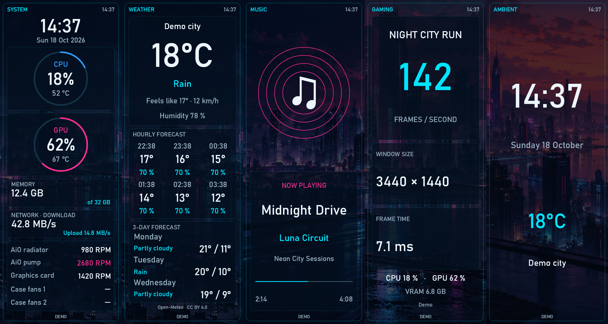

# LOU Control Center 2.2.2 — larger portrait text

Prepared for testing; not yet published as a stable GitHub release. The currently published stable downloads remain 2.2.1.

## Readability

This update addresses [issue #3](https://github.com/Sandoiitchisan/LOU-Control-Center/issues/3): portrait pages worked, but text was too small. Labels and readings are larger across System, Weather, Music, Gaming, Ambient and the dedicated cooling view.

In **Displays**, select a screen, adjust **Portrait text size**, then **Save and apply**. The slider runs from **100% to 150%**, with **125% by default**, including when loading older settings. Each display retains its own choice. French and English are included in the same application.

Text occupies separate, bounded areas. Values fit the available width; long names may be shortened with an ellipsis. Small portrait panels use wider hourly forecast rows while retaining all six forecasts. The available space limits the maximum effective size, so not every line grows by the same amount. Landscape and square layouts are unchanged.

Sensor assignments, page intervals, frame-rate settings, physical USB dimensions and read-only monitoring are preserved. This release does not add GPU RGB or GPU-screen support; that investigation is the next development target for 2.2.3.

## Packages

- `LOU-Control-Center-Setup-2.2.2-win-x64.exe`: self-contained Windows x64 installer, with the .NET runtime and existing sensor dependencies. Upgrades the universal edition and preserves its settings.
- `LOU-Control-Center-Portable-2.2.2-win-x64.zip`: extract the entire ZIP to a writable folder and launch `Lou.ControlCenter.exe`. Keep the portable `Data` folder when migrating settings.

Close other LCD-control applications before testing physical output. The personal edition remains separate. The installer is not publisher-signed.

## Verification

- 268 automated application tests passed, including default migration, independent per-display persistence, invalid-size rejection, portrait scaling and unchanged landscape/square pixels.
- 150 additional simulated renders cover five portrait geometries, both languages and 100%, 125% and 150%. Small and tall layouts were visually reviewed.
- Offline rendering plus JPEG encoding at 150% measured medians of about 9–13 ms and a worst measured 95th percentile below 16 ms on the development PC, at 480 × 1280 and 462 × 1920. These are CPU-side measurements, not physical USB/display FPS.
- The self-contained executable generated 320 previews across sixteen geometries, five pages, simulated and unavailable-data states, in French and English. Its UI review checked independent text sizes and page intervals on two detected displays, with zero USB frames sent.
- Physical readability remains to be confirmed by the reporter. No new installer execution or hardware-output test is claimed; the running personal edition was left untouched.

The existing display-protocol limits and [licensing provenance review](LICENSING_REVIEW.md) remain unchanged.
